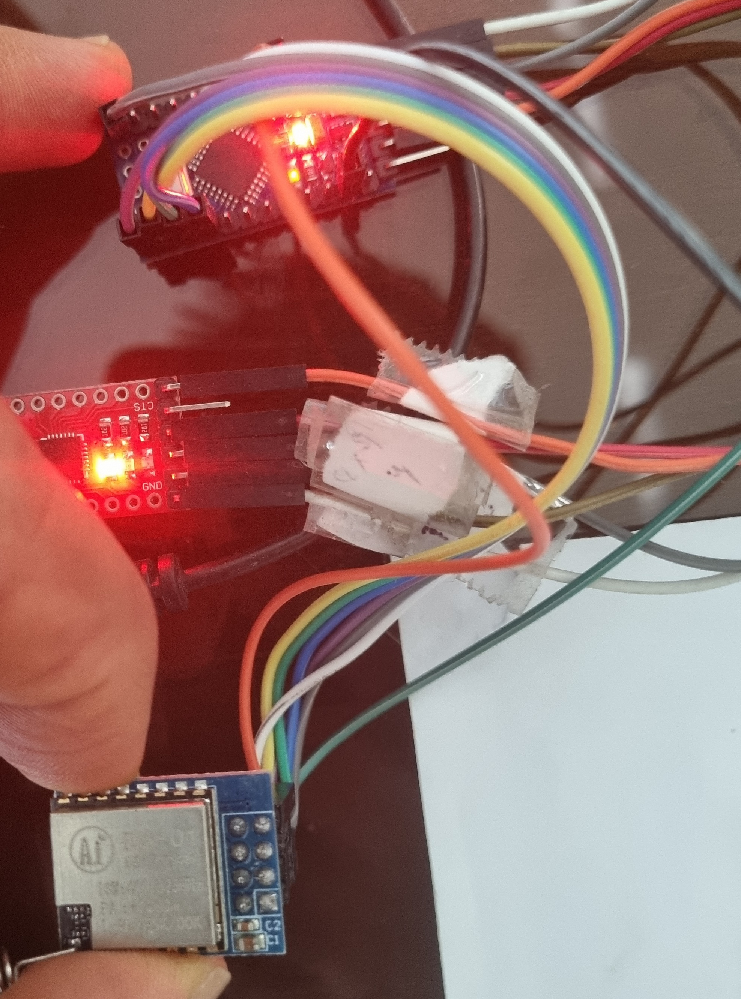
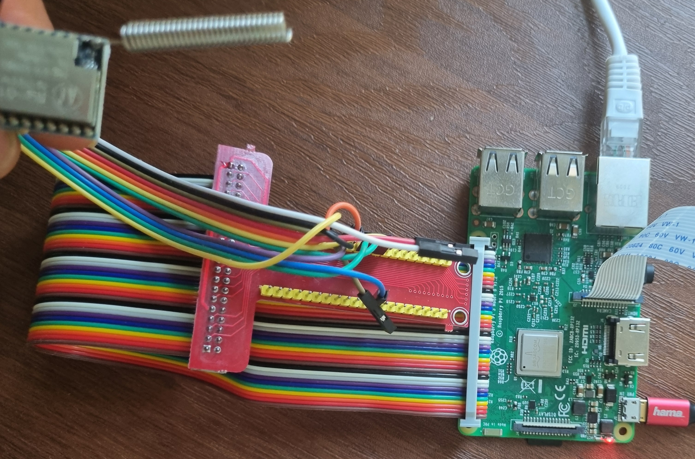
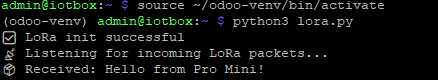

# LoRa receiver experiment: Raspberry Pi and Arduino

This directory contains a Python SX127x receiver for a Raspberry Pi and an Arduino sender sketch below. The intended frequency is 433 MHz. The receiver source uses `LoRaRF`, SPI and GPIO; successful operation depends on a compatible module, matching radio settings, wiring and local radio regulations.

## Important compatibility limits

The original `requirements.txt` lists `raspi-lora`, while the Python script imports `LoRaRF`. The current upstream `LoRaRF` API requires constructor arguments and differs from the `SX127x()`, `setPins()` and `setSpi()` calls in this script. **The compatible library/version has not been established**, so the existing installation instructions cannot be treated as tested. See the [LoRaRF project](https://github.com/chandrawi/LoRaRF-Python) and its current examples before adapting the script.

The original wiring notes conflict: the receiver comments name RESET GPIO22 while the old table mapped RESET to physical pin 22 (GPIO25); the Arduino table also assigned D2 to both software serial and DIO0. Verify the exact module and library pin numbering before wiring. The code configures NSS 8, RESET 22 and DIO0 4, but this has not been validated against physical hardware here. Some LoRa boards expose SPI, others a serial interface; do not assume the same wiring applies to both.

## Receiver

After resolving library compatibility, enabling SPI and checking wiring, the intended command from this directory is:

```bash
python3 lora_receiver_pi3.py
```

The script intends to print received UTF-8 packets. Do not expect it to run with the current upstream API without adaptation. The original `requirements.txt` is retained for historical context, not as a verified installation recipe.

## Arduino sender example

The following is the sender sketch preserved from the original documentation. It requires the Arduino SPI and LoRa libraries, suitable wiring and matching radio settings. It has not been retested for this update.

```cpp
#include <SPI.h>
#include <LoRa.h>

#define LORA_SS    10
#define LORA_RST   9
#define LORA_DIO0  2

void setup() {
  Serial.begin(9600);
  while (!Serial);
  LoRa.setPins(LORA_SS, LORA_RST, LORA_DIO0);
  if (!LoRa.begin(433E6)) {
    Serial.println("LoRa init failed. Check your connections.");
    while (true);
  }
  Serial.println("LoRa init successful!");
}

void loop() {
  Serial.println("Sending packet...");
  LoRa.beginPacket();
  LoRa.print("Hello from Pro Mini!");
  LoRa.endPacket();
  delay(5000);
}
```

## Historical illustrations

The images document a previous setup; verify their pin labels against the actual components before connecting power.




