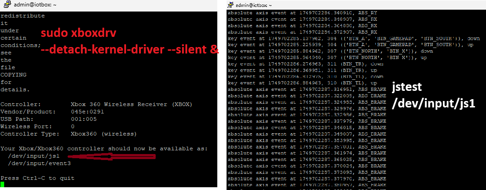
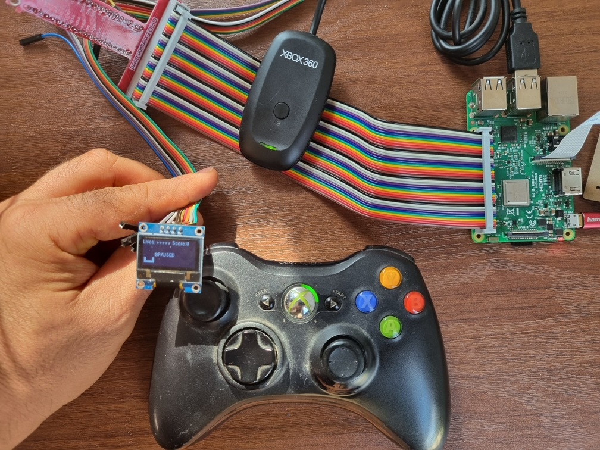
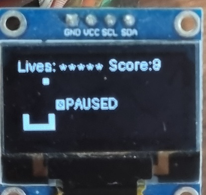

# Raspberry Pi controller and OLED experiment

This directory contains an Xbox-controller input example and historical notes for a Raspberry Pi and SSD1306 I²C OLED setup. **`snake_oled.py` is a placeholder; the Snake game is not implemented in this repository.** The images document a past setup and do not establish that the checked-in game works.

`controller_test.py` reads controller events using the `inputs` package. It requires a supported controller visible to Linux and appropriate input-device permissions. The original requirements also list `luma.oled` and `evdev` for the wider experiment; the controller test itself imports only `inputs`.

## Controller test

After configuring the controller and installing `inputs` in a suitable Python environment:

```bash
python3 controller_test.py
```

Press Ctrl+C to stop. If events are not printed, check the receiver, Linux input-device permissions and the controller's connection. This example has not been retested with physical hardware for this documentation update.

## OLED wiring notes

The original notes described SSD1306 I²C wiring using 3.3V, ground, GPIO 3 (SCL) and GPIO 2 (SDA). Verify the display's voltage and pin labels before connecting it. Enabling I²C and display software are separate setup steps; the checked-in placeholder does not drive the display.




